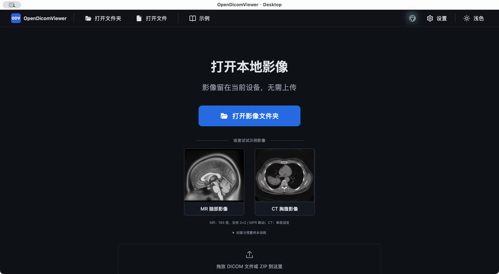

# OpenDicomViewer

[](https://github.com/Xxcool/opendicomviewer/actions/workflows/ci.yml)
[](LICENSE)


**在本机打开 DICOM，浏览原始影像与多平面重建。**

基于 React、TypeScript、Cornerstone3D 与 Tauri 2 的本地优先医学影像查看器，提供 Web 界面与桌面客户端。影像读取与解析在本机进行，无需上传到影像服务器。

**开发预览 / WIP** · [在线体验](https://opendicomviewer.pages.dev/)

[界面预览](#界面预览) · [功能清单](#当前能做什么) · [运行 Web](#运行-web) · [桌面客户端](#运行桌面客户端) · [部署与发布](#部署与发布) · [开发验证](#开发与验证) · [当前进度](docs/PROJECT_STATUS.md)

## 项目定位

OpenDicomViewer 面向研究、教学与本地影像浏览场景：从打开文件或光盘目录、浏览序列和多视口对比，逐步形成 MPR、标注测量与标准化导出的工作流。Web 与桌面端共享界面及影像处理链路，桌面端通过 Tauri 提供原生文件访问。

- **本地处理**：在用户设备上解析与解码影像，无需部署影像后端。
- **双端共享**：浏览器用于本地体验，桌面端提供原生选择器与打包运行形式。
- **数据可解释**：导入失败、空间几何问题和重建不可用原因显示在界面中。
- **分层架构**：纯 TypeScript 核心、可替换适配器与 WebGL2 渲染基线；界面采用 React 19，渲染采用 Cornerstone3D 4.22.13。

项目目标与当前交付范围分别见[浏览模式路线](docs/VIEWING_MODES_PLAN.md)和下方功能清单。

> 仅供研究、教学与非诊断参考使用。尚未经过临床验证，不用于疾病诊断、治疗决策或患者监护。

## 界面预览

### Web 与桌面入口

| Web · 浅色欢迎页 | macOS · Tauri 客户端 |
| --- | --- |
|  |  |
| 浏览器实测，2026-10-30 | macOS 实测，2026-11-01 |

两端共享工作区。桌面端增加原生文件/文件夹选择与本地读取；当前为验证版本，仍有多视口重绘与布局切换问题，详见[阶段记录](docs/reviews/DELIVERY-2026-11-01-desktop-progress.md)。

### 原始切片与 MPR 工作区


2026-10-30 浏览器实测截图，展示 ICBM152 平均头部教学模板。左上为原始切片，其余三格为降采样 MPR；四格布局不等同于 3D 体绘制。

截图使用仓库教学样本，不含本地真实性验证所用的患者数据。示例封面用于入口展示，实际样本范围见下方支持说明；这些运行记录不代表本次重新完成全部界面验收。

## 当前能做什么

| 能力 | 当前范围 |
| --- | --- |
| 本地导入 | 文件、文件夹、DICOMDIR、ZIP 的解析通路已实现；提供取消与部分失败提示，Tauri 已实测两份真实 ZIP（25/25 和 2/2 帧），Web 拖放及其余输入仍待验收 |
| 2D 浏览 | 序列列表、缩略图、翻层、调窗、平移、缩放、适应窗口与复位 |
| 独立分屏 | 2×2 各格浏览独立序列；与空间联动的 MPR 模式分开 |
| MPR | 有效空间几何的序列支持降采样三向重建、2×2 / 1+3 布局及基础翻层定位联动；定位像、普通 SC、单层或不适合建体的数据会说明原因 |
| 显示预设 | 通用及部位相关调窗预设、自动预设；实际适用范围由数据与可用元信息决定 |
| 数据提醒 | 缺层、几何、解码等问题在界面中显示；缺失标定不编造毫米或 HU 信息 |
| 外观 | 深浅主题、影像详情与专注模式 |
| 桌面运行 | Tauri 2 已在 macOS / Apple Silicon 构建并启动，原生选择文件/文件夹可用；Windows/Linux 尚未验收 |

具体支持以实际可解码的数据及几何检查为准，尚不承诺兼容所有厂商、传输语法或光盘结构。

**尚未交付：** 可编辑标注与测量、标注保存恢复、PNG/JPEG 与 DICOM/SR/GSPS 导出、2D Cine、3D 体绘制、真正的 4D 动态体积。详细范围见[导出计划](docs/EXPORT_PLAN.md)与[浏览模式路线](docs/VIEWING_MODES_PLAN.md)。

## 使用方式

| 形式 | 适合场景 | 运行条件与交付状态 |
| --- | --- | --- |
| Web | 在浏览器打开本地文件或体验教学样本 | 本地启动或自行部署静态资源；需要 WebGL2 |
| Tauri 桌面端 | 原生文件访问、无需 Vite 的打包运行 | 已在 macOS / Apple Silicon 验证基础启动与导入；Windows/Linux 待验收 |

[Web 在线预览](https://opendicomviewer.pages.dev/)已部署到 Cloudflare Pages。线上欢迎页与样本清单已打开验证，并已取得用户侧示例导入与二维显示证据；MPR 等完整交互验收仍在进行；正式客户端安装包暂未提供，也可按下方步骤从源码运行。

## 运行 Web

已验证的开发环境：Node.js 20.20.2、pnpm 12.5.1。浏览器需要可用的 WebGL2；建议先使用 Chromium 浏览器验证。

```bash
git clone https://github.com/Xxcool/opendicomviewer.git
cd opendicomviewer
pnpm install --frozen-lockfile
pnpm --filter @opendicomviewer/app-web dev
```

打开终端打印的地址。配置默认端口为 `3000`，占用时可自动切换；需要固定到之前的 `5173` 时执行：

```bash
pnpm --filter @opendicomviewer/app-web dev --host 127.0.0.1 --port 5173 --strictPort
```

进入欢迎页，选择本地影像文件夹/文件，或先打开 MR 教学示例。导入真实数据时，留意失败数量与数据提醒；单层影像可以二维浏览，但不因此具备 MPR 能力。

构建与预览：

```bash
pnpm --filter @opendicomviewer/app-web build
pnpm --filter @opendicomviewer/app-web preview
```

静态部署需复制完整的 `packages/app-web/dist/`。构建会将根目录 `sample-dicom/` 中的示例与清单一起写入产物，无需额外的示例服务。部署环境还需满足浏览器相关安全上下文与资源加载要求；部署不等于已经支持离线安装。

## 运行桌面客户端

先安装 Rust 与对应平台工具链，参见 [Tauri 前置条件](https://v2.tauri.app/start/prerequisites/)。macOS 需要 Xcode Command Line Tools；此次本机使用 Rust 1.99.1。

在仓库根目录执行：

```bash
pnpm install --frozen-lockfile
pnpm desktop:dev
```

桌面开发服务固定使用 `127.0.0.1:5174`。如终端未识别 Cargo，先按 Rust 安装提示加载其环境。

```bash
# 构建 macOS 应用
pnpm desktop:build
```

本机 macOS 输出位置：`packages/app-tauri/src-tauri/target/release/bundle/macos/OpenDicomViewer.app`。打包应用包含前端、Worker、解码资源与教学样本，运行不依赖 Vite 服务。

目前没有经签名、公证的正式安装包。桌面重绘问题、跨平台验证和文件授权生命周期仍在完善，详见[客户端说明](packages/app-tauri/README.md)。

## 部署与发布

当前已接入 [GitHub CI](.github/workflows/ci.yml)，在 `main` 推送及相关 PR 上执行类型检查、lint 和测试。Cloudflare Pages 已完成首次部署并连接 `main` 自动构建；桌面安装包签名与自动发版仍待接入，目前推送版本标签不会自动创建 Release 或上传安装包。

### Web · Cloudflare Pages

项目已通过 Pages Git 集成连接本仓库，访问地址为 https://opendicomviewer.pages.dev/ 。下表为首次部署实际应用的配置；部署与验收记录见[线上部署记录](docs/reviews/DELIVERY-2026-11-02-cloudflare.md)。

| 配置项 | 值 |
| --- | --- |
| 仓库 / 生产分支 | `Xxcool/opendicomviewer` / `main` |
| 框架预设 | 不使用预设（自定义构建命令） |
| 项目根目录 | 仓库根目录，保留默认值 |
| 构建命令 | 见下方命令 |
| 构建输出目录 | `packages/app-web/dist` |
| 构建环境变量 | `NODE_VERSION=20.20.2`、`PNPM_VERSION=12.5.1`、`SKIP_DEPENDENCY_INSTALL=1` |

```bash
pnpm install --frozen-lockfile && pnpm typecheck && pnpm lint && pnpm test && pnpm --filter @opendicomviewer/app-web build
```

Pages 的 Git 自动部署与 GitHub CI 独立运行，不会天然等待 CI 通过，因此在 Pages 构建命令中也执行检查，失败时停止部署。版本变量固定当前已验证的工具链，关闭平台自动安装后由上述命令按锁文件安装依赖。

推送 `main` 会触发生产部署；需核对 Pages 部署结果及对应提交。站点只发布完整的 `dist/`，包含教学样本清单、Worker 与解码资源。应用无需影像后端地址或服务端启动步骤。

线上验收包括：欢迎页与静态资源、MR/CT 示例、本地文件/文件夹和 ZIP 导入、调窗翻层、多视口/MPR、主题切换与刷新；同时检查浏览器错误和网络请求。只有实际验证通过的功能才标为可用，样本及封面须满足公开再分发要求。

若生产版本出现问题，可在 Pages 中回滚到先前成功的生产部署；回滚不会修复仓库代码，后续推送前仍需修正问题。配置依据：[构建配置](https://developers.cloudflare.com/pages/configuration/build-configuration/)、[工具链版本](https://developers.cloudflare.com/pages/configuration/build-image/)、[Git 集成](https://developers.cloudflare.com/pages/configuration/git-integration/)、[回滚](https://developers.cloudflare.com/pages/configuration/rollbacks/)。

### 桌面 · 构建与分发

目前可执行的是 macOS 本地 `.app` 构建：

```bash
pnpm install --frozen-lockfile
pnpm typecheck
pnpm lint
pnpm test
cargo test --manifest-path packages/app-tauri/src-tauri/Cargo.toml
cargo fmt --check --manifest-path packages/app-tauri/src-tauri/Cargo.toml
pnpm desktop:build
```

产物为 `packages/app-tauri/src-tauri/target/release/bundle/macos/OpenDicomViewer.app`。当前脚本固定 `--bundles app`，不生成 DMG、Windows 或 Linux 安装包。正式桌面分发还需完成目标平台构建、签名/公证及真机验收，详见 [Tauri 分发说明](https://v2.tauri.app/distribute/)和[客户端说明](packages/app-tauri/README.md)。

### 版本发布 · GitHub Releases

正式发版采用以下流程；当前仍处于开发预览阶段：

1. 确定版本和发布范围，核对 Web、桌面 `package.json`、`tauri.conf.json` 与 Rust `Cargo.toml` 的版本；Rust 版本变化时同步生成对应 `Cargo.lock`。预览版本明确标识为预发布。
2. 选择干净的发布提交，完成 CI、Web 构建及目标平台打包；在实际部署站点或安装产物中验收，记录操作系统、架构、已知问题和支持范围。
3. 更新发布说明，列出变更、限制、安装/升级方式及样本许可；为分发文件生成 SHA-256 校验清单。
4. 发布时为已验收提交创建 `vX.Y.Z` 标签，在 [GitHub Releases](https://github.com/Xxcool/opendicomviewer/releases) 创建对应版本，上传经过验收的产物和校验清单。发布前先准备为草稿，预览版本选择 Pre-release。
5. 下载发布资产再次核验哈希与启动行为，再更新 README 中的在线体验、安装包及版本链接。

尚待实现的自动化：跨平台安装包构建、签名/公证、校验清单生成与 Release 上传、客户端更新。补齐前按上述流程逐项执行，不将本地构建成功等同于发布完成。

## 开发与验证

```bash
pnpm test
pnpm typecheck
pnpm lint

# 桌面 Rust 检查
cargo test --manifest-path packages/app-tauri/src-tauri/Cargo.toml
cargo fmt --check --manifest-path packages/app-tauri/src-tauri/Cargo.toml
```

测试与构建通过不代表界面、性能、跨平台和真实数据验收全部完成。各轮结果和限制记录在 [docs/reviews/](docs/reviews/)。

```text
packages/
  core/              领域模型、端口、几何排序与体积处理
  adapters/
    source-local/    DICOM / DICOMDIR / ZIP 与本地输入
    codec-wasm/      像素解码
    renderer-cs3d/   Cornerstone3D 渲染适配器
  app-web/           React 界面与组合根
  app-tauri/         Tauri 2 外壳、原生选择与受限文件读取
sample-dicom/        教学样本及来源材料
docs/                架构、计划、评审与验收证据
```

数据流：本地输入 → 候选文件 → 解析/序列组织 → 按需像素解码 → 渲染；MPR 另经几何校验与降采样体积路径。原始切片走全分辨率浏览，显示用体积不能替代原始数据上的数值测量。

- [架构设计](docs/ARCHITECTURE.md)与[编码约束](GEMINI.md)
- [项目进度与开源准备](docs/PROJECT_STATUS.md)
- [标注与测量交互计划](docs/ANNOTATION_PLAN.md)
- [导出格式与互操作计划](docs/EXPORT_PLAN.md)
- [2D / MPR / 3D / Cine / 4D 路线](docs/VIEWING_MODES_PLAN.md)

## 隐私与已知限制

- 本地输入在本机处理，未接入影像上传服务、第三方字体或分析上报。示例通过当前应用来源加载；主动点击 GitHub 链接会访问外部网站。完整跨平台禁网流程尚未验收，不能将本地处理宣传为完整网络审计通过。
- 桌面多格、主题及布局切换组合下已发现画面变暗、文字缺笔及切面呈现异常；当前优先修复，暂不声明桌面稳定可用。
- 隐藏患者信息覆盖层不等于脱敏，像素中可能已烧录身份信息。真实患者文件、截图和完整本地路径不应提交到仓库或公开反馈中。

## 教学样本

内置影像用于功能演示与教学，其中 MR 头部示例派生自 ICBM152 平均模板。样本与第三方资源的许可独立于代码许可，来源、使用限制及重现步骤见[头部样本说明](sample-dicom/brain-head-mr/README.md)及各资源目录中的来源记录。

## 👨‍💻 作者 (Author)

- **Xxcool** · [GitHub (@Xxcool)](https://github.com/Xxcool) · [掘金技术主页](https://juejin.cn/user/4265760845468296/posts)

## 📄 开源许可 (License)

本项目代码采用 [Apache License 2.0](LICENSE) 开源协议。教学样本、示例封面及第三方资源遵循各自许可，详见相应目录中的来源与许可说明。
