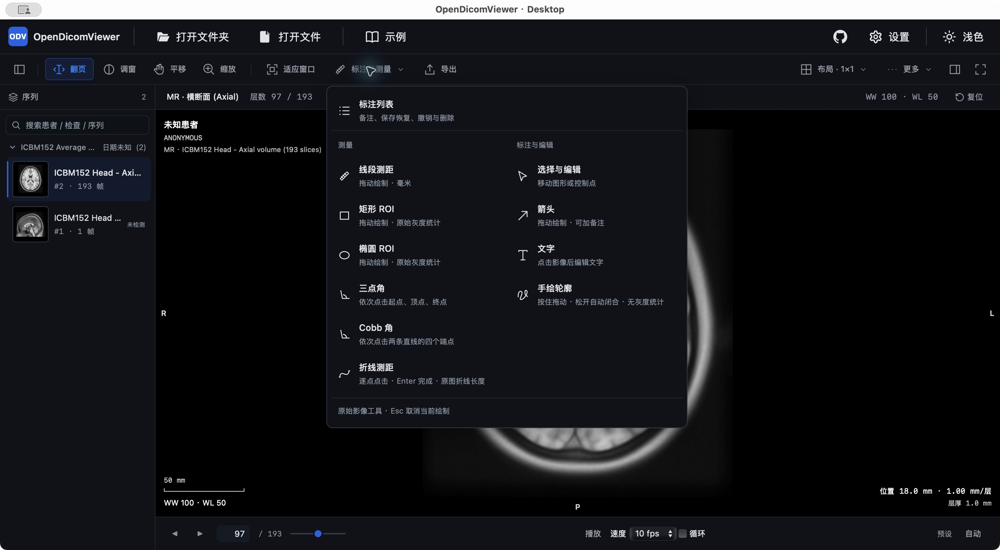

# OpenDicomViewer

[](https://github.com/Xxcool/opendicomviewer/actions/workflows/ci.yml)
[](LICENSE)

**本地优先的开源 DICOM 影像查看器。**

在浏览器或桌面客户端打开本地影像，完成二维浏览、多视口对比、MPR、标注与测量。影像在当前设备上读取和处理，无需上传到影像服务器。

[在线体验](https://opendicomviewer.pages.dev/) · [下载客户端](https://github.com/Xxcool/opendicomviewer/releases) · [功能与限制](#功能与限制) · [快速开始](#快速开始) · [更新日志](CHANGELOG.md)

> 当前为预览版本。仅供研究、教学与非诊断参考使用，未经临床验证，不用于疾病诊断、治疗决策或患者监护。

## 界面预览

### 多视口与 MPR


### 标注与测量



截图使用 ICBM152 平均头部教学样本，不含本地真实性验证使用的患者影像。

## 功能与限制

| 功能 | 支持范围 |
| --- | --- |
| 本地导入 | DICOM 文件、文件夹、DICOMDIR 与 ZIP；导入进度、取消及部分失败提示 |
| 二维浏览 | 序列缩略图、翻层、调窗、平移、缩放、适应窗口、复位与二维播放 |
| 多视口 | 独立 2×2 分屏；有效体积支持 MPR 2×2 / 1+3 与基础空间定位联动 |
| 标注与测量 | 原始单视口的直线/折线测距、矩形/椭圆 ROI、三点角/Cobb、箭头、文字与手绘轮廓 |
| 编辑与保存 | 控制点编辑、备注、删除、撤销/重做、JSON 保存恢复与未保存保护 |
| 影像导出 | PNG 预览、Web 下载与桌面原生保存；完整原始 DICOM 实例/序列导出，不覆盖原图 |
| 界面 | 深浅主题、部位调窗预设、影像详情、数据提醒与专注模式 |

- 测量目前限 **1×1 原始 Stack**；MPR 使用降采样体积显示与定位，不作为测量真源。ROI 显示变换后灰度统计，单位尚未确认；手绘只保存轮廓和备注。
- 桌面原始 DICOM 导出目前支持原生选入的文件/文件夹；ZIP 展开项与内置样本的桌面原始导出尚不支持。原始 DICOM 不包含本次新增标注，且未经脱敏。
- macOS 的 MPR 在反复切换布局/主题时仍有重绘问题。Windows 安装包的构建验证与实际界面验收分别记录，不以打包成功宣称完整兼容。
- DICOM SR/GSPS、3D 体绘制、真正的 4D 动态体积尚未交付；不承诺兼容全部厂商、传输语法或光盘结构。

完整范围与已知问题见[项目状态](docs/PROJECT_STATUS.md)。

## 下载与使用

在 [GitHub Releases](https://github.com/Xxcool/opendicomviewer/releases) 选择匹配系统和处理器架构的客户端。预览包的签名状态、支持范围及 SHA-256 校验清单以对应 Release 说明为准。

也可直接[在线体验](https://opendicomviewer.pages.dev/)。打开后选择本地文件/文件夹，或先载入教学示例。浏览器需要 WebGL2。

测量与标注工具位于顶部菜单，右侧列表用于编辑和保存。折线逐点点击后按 Enter 完成；手绘松开后闭合；Esc 取消当前绘制。

隐藏姓名或关闭身份叠加不等于脱敏，源像素和原始标签中可能仍含身份信息。请勿将真实患者文件、截图或身份信息提交到公开仓库。

## 快速开始

开发环境：Node.js 20、pnpm 12。桌面开发还需 Rust 和对应平台的 [Tauri 前置工具](https://v2.tauri.app/start/prerequisites/)。

```bash
git clone https://github.com/Xxcool/opendicomviewer.git
cd opendicomviewer
pnpm install --frozen-lockfile

# Web
pnpm --filter @opendicomviewer/app-web dev

# 桌面
pnpm desktop:dev
```

打开终端打印的本地地址。构建与检查：

```bash
pnpm typecheck
pnpm lint
pnpm test
pnpm --filter @opendicomviewer/app-web build
pnpm desktop:build
```

项目采用 React 19、TypeScript、Cornerstone3D 4.22.13 和 Tauri 2。`packages/core` 提供领域模型与端口，`packages/adapters` 处理本地输入、解码及渲染，Web 与桌面共享工作区。

[架构说明](docs/ARCHITECTURE.md) · [客户端开发](packages/app-tauri/README.md) · [开发计划](docs/IMPLEMENTATION_PLAN.md)

## 教学样本

内置 MR 头部影像派生自 ICBM152 平均模板。教学样本及第三方资产遵循各自许可，来源与限制见[样本说明](sample-dicom/brain-head-mr/README.md)及对应资源目录；项目代码许可不覆盖第三方影像。

## 👨‍💻 作者 (Author)

- **Xxcool** · [GitHub (@Xxcool)](https://github.com/Xxcool) · [掘金技术主页](https://juejin.cn/user/4265760845468296/posts)

## 📄 开源许可 (License)

本项目代码采用 [Apache License 2.0](LICENSE) 开源协议。教学样本、封面及第三方资源遵循各自许可。
