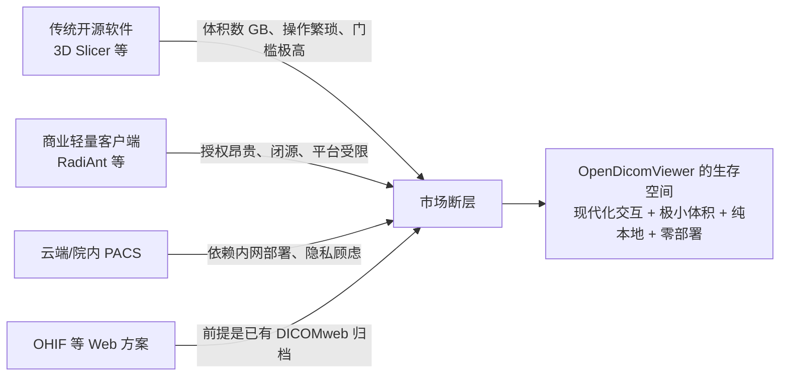
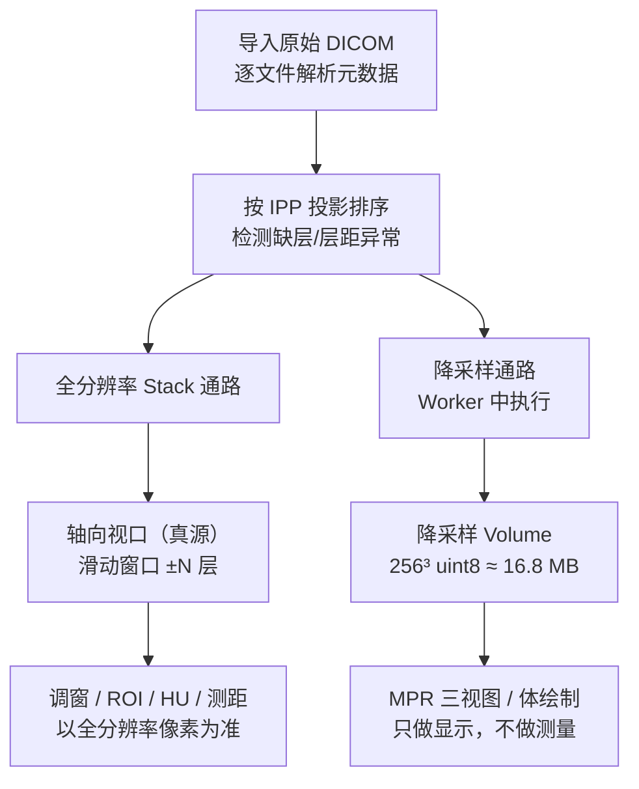
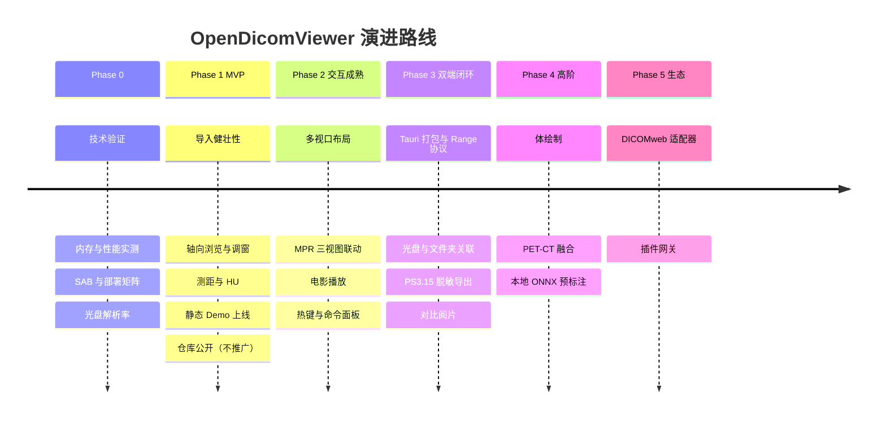

# 现代开源医学影像（DICOM）阅片平台 产品与技术架构方案

**版本**：v2.0
**日期**：2026-10-27
**状态**：设计定稿，待 Phase 0 技术验证回填实测数据
**前序版本**：v1.0（2026-10-27）

---

## 0. 本版变更说明

v2 在 v1 的产品叙述与技术选型基础上，补齐了"可执行性"与"专业正确性"两块缺失，并修正了三处会误导实现的技术表述。

| # | 变更 | 类型 | 对应 v1 缺陷 |
| --- | --- | --- | --- |
| 1 | 新增「竞品定位」章节，正面回答"为什么不是 OHIF" | 定位 | v1 未提及最大竞品 |
| 2 | 新增「预期用途与非目标」，明确非诊断定位 | 合规 | v1 无任何合规声明 |
| 3 | 新增内存模型、双精度渲染路径、设备降级矩阵 | 架构 | v1 无内存预算，MPR 方案不可行 |
| 4 | WebGPU 改为"WebGL2 基线 + WebGPU 实验性增强" | 修正 | v1 把实验特性写成地基 |
| 5 | "60 FPS 以上" 改为可验收的 p95 帧时间指标 | 修正 | v1 指标不可验收 |
| 6 | 新增「DICOM 数据正确性规范」 | 专业 | v1 缺排序/HU/多帧/MPR 几何 |
| 7 | 新增「隐私、安全与脱敏」，脱敏按 PS3.15 重写 | 专业 | v1 脱敏描述过于天真 |
| 8 | 新增端口层（Ports）与状态管理分工 | 架构 | v1 分层职责边界不清，双状态源冲突 |
| 9 | 新增「性能预算」「测试策略」「风险登记」「依赖审计」 | 工程 | v1 全缺 |
| 10 | 路线图新增 Phase 0 技术验证；**开源与推广分离**（仓库可早建，发声必须有 Demo 门槛） | 计划 | v1 先写代码后验证 |
| 11 | 新增字符集处理规范（7.6），区分文件名与标签值两条线 | 专业 | v1 仅一句"回退 GBK" |
| 11 | 设计原则由 4 条扩为 6 条（增"正确性优先""诚实的边界"） | 原则 | v1 缺少医疗软件最核心的取向 |

---

## 一、项目定位与愿景

### 1.1 基本信息

| 项 | 内容 |
| --- | --- |
| 项目名 | **OpenDicomViewer**（v1 暂定名 `OpenDicomViewer`；备选 `LuminaDICOM` 已弃用） |
| 命名取向 | **描述型优先于品牌型**：主动放弃记忆点，换取可搜索性与零理解成本。差异化的表达交给副标——"本地优先的开源 DICOM 阅片器"。**待办：正式对外前完成商标与域名检索**（`Open` 前缀+品类 是最拥挤的命名范式，撞车概率高） |
| 定位 | **零安装、重隐私、极速流畅、现代化**的开源医学影像浏览器与分析套件 |
| Tagline | "像看照片一样看 CT —— 纯本地运行，守护每位患者的隐私。" |
| 授权 | **Apache-2.0**（优于 MIT：含明确专利授权与商标条款，医疗相关项目更稳妥） |
| 目标用户 | 患者/家属（看自己的光盘）、临床医生与规培生（快速阅片）、医学研究员与 AI 开发者（数据查看与预标注） |

### 1.2 一句话差异化

> **别人做的是"连上归档看片子"，我们做的是"手上只有一张光盘也能看片子"。**

### 1.3 为什么不是 OHIF（必答问题）

Cornerstone3D 由 OHIF 团队主导维护，OHIF Viewer 本身是 MIT、当前 v3.12.x、已有 MPR / 分割 / 体绘制 / SR-GSPS / Hanging Protocol。任何技术评审的第一个问题都会是"为什么不用 OHIF 改一改"。答案不是"我们更好"，而是**数据入口假设不同**：

| 维度 | OHIF | OpenDicomViewer |
| --- | --- | --- |
| 数据入口前提 | **必须存在 DICOMweb 归档服务**（Orthanc / dcm4chee / 云 PACS） | **本地文件、文件夹、光盘、zip**，无任何服务端 |
| 典型部署 | 院内服务器 + 前端容器，需 IT 运维 | 静态托管 / 拷进 U 盘的单个应用 |
| 离线可用 | 需先完成部署 | 原生离线 |
| 使用门槛 | 医生需知道"找信息科要地址" | 拖进去就能看 |
| 定位 | 院内影像平台的 Web 前端 | **个人级影像查看器** |
| 扩展方式 | 自定义 mode / extension，需前端工程能力 | 开箱即用 + 后期插件 |

**结论**：OHIF 是"平台"，本项目是"工具"。二者不构成替代关系，但必须避免在功能清单上与其正面竞争（我们永远做不过一个 NIH 资助、每周发版的团队），而应在**本地文件路径的健壮性、首屏速度、安装体积、界面克制**这四个维度建立不可替代性。

### 1.4 竞品全景

| 维度 | OHIF | Weasis | RadiAnt | 3D Slicer | dwv | **本项目** |
| --- | --- | --- | --- | --- | --- | --- |
| 数据入口 | DICOMweb 归档 | 本地 + DICOMweb | 本地 / 光盘 | 本地 | 本地 / URL | **本地 + 光盘，零依赖** |
| 部署成本 | 需部署归档 | 桌面安装 | 桌面安装 | 数 GB 安装 | 零 | **零（静态托管 / 单文件）** |
| 离线 | 需先部署 | ✅ | ✅ | ✅ | 部分 | ✅ |
| MPR | ✅ | ✅ | ✅（专业版） | ✅ | 有限 | ✅（降采样） |
| 体绘制 | ✅ | 有限 | ❌ | ✅（强） | ❌ | 降级实现 |
| 界面现代化 | 中 | 中 | 老旧 | 老旧 | 中 | **强（核心差异）** |
| 移动端 | 有限 | ❌ | ❌ | ❌ | 有限 | 只读浏览 |
| 光盘即插即用 | ❌ | ✅ | ✅ | ❌ | ❌ | **✅（重点打磨）** |
| 授权 | MIT | EPL | 商业 | BSD | 免费 | Apache-2.0 |

---

## 二、预期用途与非目标

### 2.1 预期用途声明（Intended Use）

> **OpenDicomViewer 仅供研究、教学与非诊断参考使用（For research, educational and non-diagnostic reference use only）。**
> 本软件不构成医疗器械，不用于疾病诊断、治疗决策或患者监护。软件显示结果未经临床验证，不保证符合 DICOM GSDF 校准显示要求。测量数值仅供参考。

该声明必须同时出现在：**README 首屏、应用启动闪屏、关于页、导出图片/报告的水印或页脚**。

### 2.2 监管定位（用于规划，不用于规避）

| 地区 | 若用于诊断将落入 | 路径 | 本项目的处理 |
| --- | --- | --- | --- |
| 中国 | 医疗器械软件（二类起） | NMPA 注册 + 体系考核 | 明确非诊断用途，不做临床宣称 |
| 美国 | 影像显示类器械 Class II | 510(k) | 同上 |
| 欧盟 | MDR Class IIa | 公告机构 CE | 同上 |

**工程约束（硬性）**：

- 任何功能命名不得使用"诊断""诊断报告""诊断结论"等表述。
- 不实现"结构化诊断报告"生成，仅支持导出图像与测量数据。
- 测量面板固定展示"测量值仅供参考，未经临床验证"。
- 不做"AI 辅助诊断"宣称，AI 能力一律表述为"预标注 / 研究工具"。

### 2.3 非目标（Non-goals）

| 不做 | 原因 |
| --- | --- |
| ❌ PACS / 归档服务（长期存储、检索、HL7、DICOM 网络服务） | 一旦做就进入医疗器械与运维双重负担 |
| ❌ C-STORE SCP（作为 DICOM 节点接收影像） | 同上，且需网络监听，违背零后端原则 |
| ❌ 诊断报告生成 | 合规红线 |
| ❌ V1 移动端 MPR / 体绘制 | 内存与性能不可行，见第五节 |
| ❌ 多用户协作 / 云端同步 | 个人版永不上传是核心承诺 |
| ❌ DICOM 打印排版（Film Composer） | 边缘需求，成本极高 |
| ❌ 全切片病理（WSI） | 数据量级完全不同（GB 级单文件），另立项目 |

---

## 三、背景与核心痛点



1. **隐私合规红线**：Web 方案普遍要求上传或依赖服务端，触碰患者数据合规边界。纯本地运行是唯一"无需信任"的方案。
2. **轻量与易用性断层**：缺少一个像 Excalidraw 一样"拖入即开、无需配置"的影像工具。医生不应该为了看一张片子去部署一个归档系统。
3. **平台碎片化**：Windows 办公机、macOS 便携本、iPad 之间体验割裂。
4. **中国场景的特殊性**：医院内网普遍无外网，云方案直接不可用；患者拿到的光盘往往只有厂商自带的、体验极差的查看器。**"离线可用"在本土市场不是加分项，是入场券。**

---

## 四、设计原则

> v1 的四条原则保留了精神，但补上了两条更根本的，并把口号全部改成可验收的表述。

### 原则 1：正确性优先于流畅（Correctness First）

医疗软件的第一属性是**不骗人**。层序不能错、HU 不能错、测量不能错、缺层必须提示而不是静默插值。任何性能优化如果以牺牲数值正确性为代价，一律否决。

> 验收方式：合成 phantom 的像素级 golden test 通过率 100%。

### 原则 2：零后端，且可被验证（Verifiable Zero-Backend）

默认纯前端本地运算，不回传任何像素或隐私数据。**但"零回传"不能只写在文案里**——必须以自动化测试证明，并作为 CI 门禁。

> 验收方式：Playwright 拦截全流程网络请求，断言外部域名请求数 = 0。

### 原则 3：单核双端，端口隔离（One Core, Dual Delivery）

一套 TypeScript 内核同时投递 Web 与 Tauri。宿主差异必须收敛在端口实现内，**领域核心不得出现 `window` / `tauri` / `fetch` 等宿主 API**。

> 验收方式：核心包 ESLint 禁止导入宿主模块；CI 对 `packages/core` 做依赖边界检查。

### 原则 4：可量化的响应性（Measured Responsiveness）

"极速"必须是数字。目标：**调窗与翻页 p95 帧时间 < 16.7 ms，连续翻页 200 帧零掉帧**。（注：显示器物理刷新普遍为 60 Hz，"60 FPS 以上"不是有效指标。）

> 验收方式：帧时间埋点 + CI 基准对比，回归超过 10% 即失败。

### 原则 5：诚实的边界（Honest Boundaries）

做不到的能力要显式告知，而不是降级后假装正常。设备不支持体绘制就隐藏入口；序列缺层就标黄告警；解码失败就明确报错并允许跳过。

> 验收方式：所有降级路径有对应 UI 提示；不允许静默降级。

### 原则 6：现代克制的美学（Modern & Clean）

告别上世纪的灰暗工业界面，暗色为主、呼吸感微交互。但克制的底线是**信息密度不降**——医学影像不需要留白，需要的是秩序。

---

## 五、硬约束与资源预算

> 这一节是 v1 最大的空白，也是决定架构形态的关键。

### 5.1 内存模型（真实量级）

| 对象 | 计算 | 占用 |
| --- | --- | --- |
| 单层 512×512 int16 | 512 × 512 × 2 B | 0.5 MB |
| 1000 帧原始像素 | 0.5 MB × 1000 | **512 MB** |
| 全分辨率 volume（uint16） | 与原始等量 | **512 MB** |
| GPU 侧 R16 3D 纹理 | 与体素等量 | **512 MB 显存** |
| 完整链路峰值 | 原始 + volume + 纹理 + 解码缓冲 | **1.5 GB+** |

**可用预算的现实**：

| 环境 | 单页可用内存 | 结论 |
| --- | --- | --- |
| Chrome / Edge 桌面 | 约 2–4 GB（实用上限） | 全分辨率可行但吃紧 |
| 集显笔记本 | 显存与内存共享 | 全分辨率不可行 |
| **iPad Safari** | **500 MB–1 GB 后被 Jetsam 杀进程，无回调** | **全分辨率必然崩溃** |
| 手机 | 更低 | 只能只读浏览 |

**结论**：v1 的"Cornerstone3D Volume + 1024 帧"组合在移动端从架构上不成立。必须引入双精度路径。

### 5.2 双精度渲染路径（核心架构决策）



**规则约定**：

| 通路 | 数据 | 用途 | 是否可作测量依据 |
| --- | --- | --- | --- |
| 全分辨率 Stack | 原始像素，滑动窗口驻留 | 轴向显示、调窗、ROI 统计、测距 | ✅ **唯一真源** |
| 降采样 Volume | 约 256³ uint8（或 256×256×N） | MPR 联动、体绘制、定位线、交叉准星 | ❌ 仅显示 |

**设计理由**：

- 层厚 1 mm 的 CT 降到约 2 mm 重建，**视觉上几乎无损**（冠状/矢状重建本身已做插值），但内存下降 30 倍。
- 调窗与 HU 统计必须用原始像素，否则 ROI 均值会因灰度量化产生系统偏差。
- 滑动窗口驻留策略：桌面 ±64 层，移动端 ±16 层，配合方向性预取（翻页方向优先）。

**实现要点**：

- 降采样在导入阶段的 Worker 中一次完成，产出 `Uint8Array`，通过 `Transferable` 交还主线程。
- 降采样不做临床用途，因此**使用 8-bit 窗口映射时须固定映射区间**（如 -1024 ~ 3071 线性映射），避免不同窗口下 MPR 观感跳变。
- 若用户切换伪彩或大幅调窗，需从 Stack 通路按需重新采样，而非重算整个 Volume。

### 5.3 设备 × 功能降级矩阵

| 功能 | 桌面独显 | 桌面集显 | iPad / 平板 | 手机 |
| --- | --- | --- | --- | --- |
| 轴向 stack 浏览 | ✅ | ✅ | ✅ | ✅ |
| 调窗 / 缩放 / 平移 / 翻页 | ✅ | ✅ | ✅（手势） | ✅（手势） |
| 测距 / ROI / HU | ✅ | ✅ | ✅ | ⚠️ 粗测，提示精度 |
| 多视口布局 | ✅ | ✅ | ⚠️ 1×1 / 2×1 | ❌ |
| MPR 三视图 | 全分辨率采样 | 降采样 | 降采样 | ❌ 隐藏入口 |
| 体绘制 | ✅ | ⚠️ 降质量 | ❌ 隐藏入口 | ❌ |
| PET-CT 融合 | ✅ | ✅ | ⚠️ | ❌ |
| 批量脱敏导出 | ✅ | ✅ | ❌ | ❌ |

> 实现方式：启动时能力探测（`navigator.deviceMemory`、WebGL 参数、`matchMedia` 触控），产出 `CapabilityProfile`，注入渲染层与 UI 层。**降级必须是显式的**（入口置灰 + 说明文案），不允许静默失败。

### 5.4 内存预算表（Phase 0 后回填实测）

| 场景 | 原始像素 | Volume | GPU 纹理 | 解码缓冲 | 峰值预算 |
| --- | --- | --- | --- | --- | --- |
| 桌面 / 1000 帧 512² | 512 MB | 16.8 MB | 512 MB（或跳过 VR 不入纹理） | ~64 MB | ≤ 1.1 GB |
| 桌面 / 300 帧 | 154 MB | 16.8 MB | 154 MB | ~32 MB | ≤ 400 MB |
| iPad / 1000 帧 | 滑动窗口 8 MB | 256×256×250 ≈ 16.4 MB | 不入 3D 纹理 | ~16 MB | ≤ 120 MB |
| iPad / 300 帧 | 滑动窗口 8 MB | 16.8 MB | 不入 3D 纹理 | ~16 MB | ≤ 120 MB |

---

## 六、系统技术架构

### 6.1 分层总览

系统采用 **六边形架构（Ports & Adapters）**：领域核心居中，所有宿主与外部能力通过端口接入。v1 的"微内核 + 适配器"方向正确，但缺少端口层的显式定义，导致"单核双端"在执行时会退化成两套代码。

```mermaid
flowchart TD
    subgraph HOST["6 宿主外壳"]
        H1["Web / PWA<br/>纯静态托管"]
        H2["Tauri 2<br/>Rust I/O + Range 协议"]
    end

    subgraph APP["1 应用层（React 19 + Tailwind + Radix）"]
        A1["顶部工具栏 / 布局切换"]
        A2["多格视口网格"]
        A3["序列栏 / 元数据 / 测量面板"]
        A4["能力降级提示 / 错误边界"]
    end

    subgraph CORE["2 领域核心（与 UI 框架无关，纯 TS）"]
        C1["Study 索引与序列排序<br/>IPP 投影 + 缺层检测"]
        C2["呈现状态模型<br/>VOI / 相机 / 十字准星"]
        C3["测量与标注模型<br/>几何 + 精度规则"]
        C4["任务编排<br/>导入 / 解码 / 降采样 / 预取"]
    end

    subgraph PORT["3 端口层（仅接口定义）"]
        P1["DataSourcePort"]
        P2["CodecPort"]
        P3["RendererPort"]
        P4["StoragePort"]
        P5["TelemetryPort"]
    end

    subgraph PLAT["4 平台能力实现"]
        I1["LocalFileSource<br/>DICOMDIR / zip / 目录"]
        I2["DicomWebSource<br/>WADO-RS（默认关闭）"]
        I3["WASM 解码池<br/>OpenJPEG / CharLS / RLE"]
        I4["CS3D 渲染适配<br/>WebGL2 基线"]
        I5["OPFS / 内存标注库"]
        I6["NullTelemetry<br/>默认空实现"]
    end

    subgraph HW["5 硬件与运行时"]
        W1["Web Workers + SIMD"]
        W2["WebGL2 → WebGPU 可选"]
        W3["FileSystem / OPFS"]
    end

    HOST --> APP
    APP --> CORE
    CORE --> PORT
    PORT --> PLAT
    PLAT --> HW
```



### 6.2 端口定义

| 端口 | 职责 | Web 实现 | Tauri 实现 | 未来 |
| --- | --- | --- | --- | --- |
| `DataSourcePort` | 列举、探测、打开序列 | File API / Directory Picker | Rust 侧 Range 协议 | DICOMweb |
| `CodecPort` | 像素解码 | WASM 解码池 | 同（可复用） | 原生加速 |
| `RendererPort` | 数据 → 图像 | CS3D + WebGL2 | 同 | WebGPU |
| `StoragePort` | 标注、偏好、缓存 | IndexedDB / OPFS | 同 + 原生文件 | 加密存储 |
| `TelemetryPort` | 诊断与性能埋点 | **NullTelemetry（默认）** | 本地日志文件 | 用户显式 opt-in |

接口草案见附录 A。

### 6.3 关键机制

**1. 计算零阻塞**

- DICOM 解析、解压、降采样全部在 Worker 中执行，主线程只负责调度与合成。
- 多 Worker 并发解码，配合 WASM SIMD；解码池大小按 `navigator.hardwareConcurrency` 自适应（上限 8）。
- Worker 与主线程之间只传 `Transferable`，避免结构化克隆拷贝。

**2. 显存直通调窗**

- 窗宽窗位在片元着色器中完成线性或 Sigmoid 映射，CPU 仅更新 uniform。
- 前提是数据以纹理形式常驻显存；对 Stack 通路，纹理是逐层的（仅驻留窗口内层），对 Volume 通路是 3D 纹理。

**3. MPR 实时计算**

- 基于降采样 3D 纹理做任意截面采样，三视图通过同步器联动（相机位置同步 + VOI 同步 + 十字准星同步）。
- 采样必须使用**三线性插值**，并把体素间距（`PixelSpacing` + `SliceThickness/SpacingBetweenSlices`）作为各向异性缩放输入，否则重建几何变形。

**4. 方向性预取**

- 维护翻页方向向量，按方向预解码后续 N 层（桌面 32 / 移动 8），停顿 200 ms 后停止预取以省电。

### 6.4 状态管理分工（避免双状态源）

v1 把 Zustand 标为"全局状态驱动"，同时用 Cornerstone3D，这在实现时必然产生同步竞态——CS3D 自带 rendering engine、camera、tool state 三套内部状态。

| 状态类别 | 归属 | 说明 |
| --- | --- | --- |
| 渲染态（相机、VOI、纹理、图层） | **Cornerstone3D 唯一真源** | 应用侧只读，通过事件订阅感知变化 |
| 标注态（测量几何） | Cornerstone3D annotation state | 应用侧通过订阅 -> 转换为领域模型持久化 |
| UI 态（当前布局、面板开合、激活工具） | **Zustand** | 不参与渲染循环 |
| 会话态（当前 study/series、导入任务） | Zustand | 低频变更 |
| 能力与配置 | Zustand（初始化注入） | 只读 |

**硬性规则**：渲染循环内（拖拽调窗、滚轮翻页、测量拖拽）**不得调用 React setState**。所有高频交互通过 ref + 事件订阅处理，UI 数值显示用节流（≥100 ms）更新。

### 6.5 UI 框架选型修正

| 项 | v1 | v2 | 理由 |
| --- | --- | --- | --- |
| React | 18 | **19** | 已是默认稳定版，且 CS3D 生态已适配 |
| 样式 | TailwindCSS | TailwindCSS v4 | 构建更快，配置更简 |
| 组件 | Radix UI | Radix UI + **react-resizable-panels** + **dnd-kit** + **cmdk** | 影像界面必需：可拖拽分栏、序列排序、命令面板 |

---

## 七、DICOM 数据正确性规范

> 这一节是"是否真正做过影像"的分水岭。v1 全部缺失。

### 7.1 序列内排序

**禁止使用 `InstanceNumber` 排序。** 医院光盘数据的 InstanceNumber 错乱是常态。

正确做法：

```
sortKey = dot(ImagePositionPatient, normalOf(ImageOrientationPatient))
```

- `ImageOrientationPatient` 给出方向余弦（6 个值），法向 = 前三个与后三个的叉积。
- 按 `sortKey` 升序排序；`InstanceNumber` 仅用于 `sortKey` 相同的重复层做 tie-breaker。
- 多帧影像（Enhanced CT/MR）的帧级位置在 `PerFrameFunctionalGroupsSequence` 中，需逐帧提取。

### 7.2 灰度值换算（HU）

**必须走完整 Modality LUT 链**，否则 ROI 均值全部错误且错得隐蔽：

```
若存在 ModalityLUTSequence：storedValue → LUT 查表
否则：output = pixel × RescaleSlope + RescaleIntercept
```

再经 VOI LUT（窗宽窗位）→ Presentation LUT → 显示。

**校验手段**：用已知 phantom（水 ≈ 0 HU、空气 ≈ -1000 HU、骨 > 400 HU）做自动断言，每次发版跑一遍。

### 7.3 多帧 DICOM

单列一条数据通路，不作为"文件即一层"的例外：

| 类型 | 特征 | 处理 |
| --- | --- | --- |
| Enhanced CT/MR | 单文件多帧，帧级几何在功能组 | 逐帧展开为虚拟 imageId 列表 |
| DSA / 造影 | 多帧 + 时间维 | 支持电影播放，时间序列同步 |
| 核医学（PET/SPECT） | 多帧 + 放射性衰变 | 保留原始帧，不自动衰减校正（除非用户显式启用） |

### 7.4 MPR 几何陷阱

| 陷阱 | 现象 | 处理 |
| --- | --- | --- |
| 缺层（gap） | 重建图上出现错位/撕裂 | 检测相邻层间距突增（> 1.5× 中位数），**标黄告警**，可选"按缺失插值"并注明 |
| 层距不均 | MPR 拉伸变形 | 按实际 `ImagePositionPatient` 做非均匀重采样到均匀网格 |
| 机架倾斜（gantry tilt） | 冠状/矢状面倾斜 | 检测 IOP 非标准轴对齐，应用 affine 校正矩阵 |
| 各向异性体素 | 重建模糊或锯齿 | 采样时按 spacing 比例缩放，不使用各向同性假设 |
| 多序列空间不一致 | PET-CT 叠加错位 | 对比 `FrameOfReferenceUID`，不同则提示"需配准"而非硬叠 |

### 7.5 导入健壮性

真实光盘的解析成功率是本项目的生命线。必须覆盖：

| 场景 | 处理 |
| --- | --- |
| `DICOMDIR` | 优先解析，据其建立 study/series 树 |
| 嵌套目录（深达 5 层） | 递归扫描，跳过隐藏文件与系统文件 |
| 中文（GBK）文件名 | 见 7.6：浏览器拿不到原始字节，只做乱码还原启发式；**能否打开一律靠魔数判定，与文件名无关** |
| ISO9660 / Joliet 编码 | 使用 File API 拿到的是解码后路径，需容错乱码 |
| **无扩展名文件** | 不依赖扩展名，按文件头 128 字节偏移处的 `DICM` 魔数判定 |
| 厂商私有目录结构 | 不假设 DIR 结构，一律做全盘扫描 + 归类 |
| zip 压缩包 | 流式解包，不整包解压到内存 |
| 损坏文件 | **逐文件 try/catch**，收集失败清单，其余继续，最后汇总报告 |
| 超大文件（> 2 GB） | 分段读取，避免 `arrayBuffer()` 一次性加载 |

> 设计准则：**宁可少认一个文件，不可整批失败。**

### 7.6 字符集与编码（中国场景重点）

国内老旧设备（十年前的东芝、东软、GE 机型）导出的光盘，编码混杂是常态，县级医院尤甚。必须拆成**两条互不相干的技术线**处理——这是本节最重要的一句话，混在一起写必然出错。

#### 线 1：文件名与目录名

- **浏览器拿不到原始字节**。`File.name` 已是浏览器/操作系统解码后的 JS 字符串，`TextDecoder` 的入参是 `Uint8Array`，对文件名直接调用无效。
- 真实乱码形态：无 Joliet 的 ISO9660 光盘被按 latin-1 解读，得到 `U+0080–U+00FF` 区间的乱码串。
- 因此策略是**不依赖文件名**：识别 DICOM 一律读偏移 128 处的 `DICM` 魔数。文件名只影响"界面上显示什么"，不影响"能不能打开"——设计上把编码问题从 P0 降为 P2。
- 仅在需要展示路径时做还原启发式：字符串按 latin-1 转回字节（`charCodeAt(i) & 0xFF`），再用 `TextDecoder('gb18030')` 解码，若结果中 CJK 字符比例显著高于原串则采纳。
- **桌面端（Tauri）是唯一能拿到字节级文件名的环境**：Unix 侧 `OsStr::as_bytes()`、Windows 侧原生 UTF-16，用 `encoding_rs` 做 UTF-8 → GB18030 回退，比浏览器路径可靠得多。

#### 线 2：DICOM 标签值（主战场）

中文患者姓名、序列描述、机构名显示成乱码，几乎全部出在这里，而不是文件名。

按 `SpecificCharacterSet (0008,0005)` 派发解码器：

| SpecificCharacterSet | TextDecoder 标签 |
| --- | --- |
| 空 / 缺失 | 标准规定为 ASCII，实际按 latin-1 读后走兜底 |
| `ISO_IR 6` | `ascii` |
| `ISO_IR 100` | `iso-8859-1` |
| `ISO_IR 192` | `utf-8` |
| `GB18030` / `GBK` | `gb18030` |
| `ISO 2022 IR 58` | 先剥离 ESC 转义序列，再按 `gb18030` 解 |
| `ISO_IR 13` | `shift_jis` |
| `ISO_IR 149` | `euc-kr` |

**兜底必须存在**：不少国产机型写了中文却根本不声明 `SpecificCharacterSet`（标准要求此时按 ASCII 读，必然乱码）。策略是——解码结果含替换字符 `\uFFFD`，或高频出现 `U+0080–U+00FF` 区间字符时，用 `gb18030` 重解一次，按 CJK 字符占比择优。

`TextDecoder` 不支持带 ESC 转义的状态化编码（ISO 2022 系列），遇 `ISO 2022 IR 58` 必须先剥离转义序列。

该规则同时适用于：标签面板展示、序列描述、导出的脱敏报告、脱敏后的文件名生成。

---

## 八、隐私、安全与脱敏

### 8.1 可验证的零回传

| 措施 | 说明 |
| --- | --- |
| 全资源自托管 | 字体、图标、WASM 全部本地打包，**禁用 Google Fonts / 公共 CDN** |
| 严格 CSP | `default-src 'self'; connect-src 'self'; img-src 'self' blob: data:; worker-src 'self' blob:` |
| 无埋点 | `TelemetryPort` 默认 `NullTelemetry`，不引入任何第三方 SDK |
| 无错误上报 | 崩溃信息只写本地日志，用户可手动导出，导出前提示"日志不含影像数据" |
| **CI 门禁** | Playwright 拦截全流程请求，断言外部域名请求数 = 0；失败即阻断合并 |

### 8.2 OPFS 与持久化的隐私边界

OPFS 缓存的是**真实患者影像**，与"网页版不落盘"的直觉冲突，必须显式管理：

- 默认**关闭**持久缓存，仅在导入超大序列且用户主动开启时启用。
- 开启时弹窗明示："将在本机磁盘保留影像副本，可用于下次快速打开。"
- 提供"清空本地缓存"入口，并在隐私页展示当前占用。
- 会话结束（关闭标签页）时清理临时缓存。
- 缓存目录命名不得包含患者姓名/ID（用随机 UUID）。

### 8.3 SharedArrayBuffer 与部署矩阵

SAB 需要跨源隔离（COOP/COEP），这会连带影响第三方资源、Service Worker、嵌入场景。**GitHub Pages 无法自定义响应头，因此 SAB 在 GH Pages 上不可用。**

| 部署目标 | 能否开 COOP/COEP | SAB | 方案 |
| --- | --- | --- | --- |
| Vercel / Cloudflare Pages | ✅（配置文件） | ✅ | 全速解码池 |
| 自建 Nginx | ✅ | ✅ | 全速 |
| **GitHub Pages** | ❌ | ❌ | **降级：transferable ArrayBuffer + 并发 Worker** |
| Tauri | ✅（天然隔离） | ✅ | 全速 |
| 单文件离线版 | ⚠️（`file://` 下行为不一） | 视浏览器 | 降级 |

**降级实现**：解码结果通过 `postMessage` 转移 `ArrayBuffer` 所有权，零拷贝但无共享内存；吞吐下降约 15–25%，功能完全可用。`CodecPort` 内部做能力探测，上层无感。

### 8.4 脱敏（按 DICOM PS3.15 重写）

> v1 的"遍历重写 DICOM Tag"只是起点，漏掉的才是真正会出事的部分。

**基线**：实现 **PS3.15 附录 E 基础应用级保密性配置文件（Basic Application Level Confidentiality Profile）**，并处理以下四类非标签泄漏：

| 泄漏类型 | 风险 | 处理 |
| --- | --- | --- |
| **像素内烧录文字** | 标签全清空，但姓名/日期印在图像上——最典型的脱敏事故 | 检测 `BurnedInAnnotation` 标记；若为 YES 或未标注，提示"该序列可能含烧录信息，请人工复核"，并提供局部涂抹工具 |
| **厂商私有标签** | 标准标签已清，私有标签原样保留 | 白名单策略：**只保留必需标签，其余全部移除**（黑名单永远不全） |
| **UID 断裂** | 全改新 UID 会让多序列关联断裂；不改又泄露关联 | 维护**UID 映射表**，同一 study 内保持一致，跨 study 打散 |
| **日期关系破坏** | 各字段独立随机化，破坏"两次检查间隔 3 个月"的临床语义 | 同一患者统一偏移同一个 delta（保留间隔），未来日期做上限裁剪 |

**输出**：除脱敏文件外，同时生成**脱敏报告**（移除了哪些标签、保留了哪些、像素风险提示、待人工复核项）。这是"能证明自己干净"的唯一方式。

### 8.5 日志与崩溃转储

- 日志格式中禁止出现 `PatientName`、`PatientID`、`AccessionNumber` 等字段，只记录哈希后的短 ID。
- 崩溃转储默认不含任何影像数据；若需含，必须经用户勾选确认。

---

## 九、双端形态

### 9.1 Web 端（SPA / PWA）

| 项 | 方案 |
| --- | --- |
| 托管 | Vercel / Cloudflare Pages / 自建 Nginx（**首选自建或 CF，以启用 COOP/COEP**） |
| PWA | Service Worker 预缓存应用壳与常用解码器；wasm 按需拉取并持久缓存 |
| 更新策略 | 版本变更时提示"有新版本，刷新后生效"，不在使用中强制刷新（避免丢失标注） |
| 首屏 | 应用壳先出，wasm 流式加载，导入大序列时才拉 J2K 解码器 |
| 离线单文件版 | 额外产出**单文件 HTML 发行包**（wasm 内联），可拷进 U 盘在离网机器打开——国内场景的高价值差异化 |

### 9.2 桌面端（Tauri 2）

| 项 | 方案 |
| --- | --- |
| 体积目标 | 安装包 12–18 MB（Windows 依赖系统 WebView2；缺失时引导安装） |
| **I/O 路径** | **不走 IPC 传像素**。Rust 侧注册自定义协议（`odv://`）支持 `Range` 请求，WebView 侧按需分段读取；或 Rust 起本地回环 HTTP 服务提供 range 访问。IPC 仅用于元数据与小消息 |
| 文件关联 | 主力是**"打开文件夹"**语境 + `DICOMDIR` 自动识别；`.dcm/.dicom` 关联作为补充（光盘文件常无扩展名，扩展名关联价值有限） |
| 光盘 | 插入后扫描根目录，优先读 `DICOMDIR`，无则全盘扫描；提供"正在索引 n/m"进度 |
| 脱敏 | Rust 侧批量重写，避免大文件进出 JS |
| 签名分发 | macOS 公证（notarization）、Windows 代码签名、Tauri Updater + 签名密钥离线保管 |
| WebView 矩阵 | macOS WKWebView / Windows WebView2 / Linux WebKitGTK，三端需各自回归（WebGL2 与 OPFS 行为不一致） |

---

## 十、界面与交互

### 10.1 布局

```
┌────────────────────────────────────────────────────────────────────────┐
│  [Logo] OpenDicomViewer   |  打开文件夹  读光盘  设置      [深色/浅色]  │
├────────────┬───────────────────────────────────────────┬───────────────┤
│ 序列列表   │  视口 1: 横断面 (Axial)   [肺窗]           │ 影像元数据    │
│            │  ┌─────────────────────────────────────┐  │ 患者: 已匿名  │
│ [CT 胸部]  │  │                                     │  │ 年龄: 54Y     │
│ 1024 帧    │  │        [ 灰阶 CT 切片 ]              │  │ 检查: CT平扫  │
│ ⚠ 缺 3 层  │  │                                     │  │ 层厚: 1.0mm   │
│            │  └─────────────────────────────────────┘  ├───────────────┤
│ [CT 纵隔]  │  层数: 512/1024   WW: 1500  WL: -600      │ 测量与工具    │
│ 512 帧     │───────────────────────────────────────────│ 直线: 8.2 mm  │
│            │  快捷预设: [肺] [纵隔] [骨] [脑] [软组织]  │ 均值: -720 HU │
│ [定位像]   │                                           │ ⚠ 仅供参考    │
└────────────┴───────────────────────────────────────────┴───────────────┘
```

- 主题：极黑背景 `#0B0F17`，避免亮光干扰病灶判读；提供浅色模式（教学投屏场景）。
- 所有降级与异常状态在界面显式呈现（缺层标黄、解码失败标红、能力不支持置灰并说明）。

### 10.2 交互

**桌面热键**

| 操作 | 行为 |
| --- | --- |
| 左键拖动 | 当前激活工具（测量 / 缩放 / 画笔） |
| 右键拖动 | 实时调窗（WW/WL） |
| 滚轮 | 切片翻页（带惯性，可配置步长） |
| 空格 + 左键 | 平移画布 |
| 中键拖动 | 平移（兼容三键鼠标） |
| `1`–`5` | 预设窗口：肺 / 骨 / 纵隔 / 脑 / 腹 |
| `R` / `Shift+R` | 复位视图 / 复位全部 |
| `Ctrl/⌘ + K` | 命令面板（跳转序列、切换工具、批量操作） |
| `Esc` | 取消当前操作 |

**触控（iPad / 平板）**

| 手势 | 行为 |
| --- | --- |
| 单指拖动 | 当前工具 |
| 双指捏合 | 缩放 |
| 双指拖动 | 平移 |
| 长按 | 唤出工具轮盘 |
| 双指旋转 | 旋转（仅 MPR） |

> 明确边界：移动端只读浏览为主，MPR 与体绘制在能力不足设备上隐藏入口，不提供半残体验。

### 10.3 首屏与加载

| 状态 | 表现 |
| --- | --- |
| 应用启动 | 骨架屏 < 300 ms 出现，不空白 |
| 导入中 | 逐文件进度 + 已识别序列数 + **可取消** |
| 部分失败 | 汇总面板：成功 n / 失败 m，失败项可展开看原因，支持"仅载入成功项" |
| 大序列预热 | 首个可交互层优先渲染，其余后台预取 |

---

## 十一、性能预算与验收指标

| 指标 | 目标 | 测量方式 | 门禁 |
| --- | --- | --- | --- |
| 首屏可交互（TTI，含 wasm） | < 2.0 s | Playwright trace | 回归 > 15% 阻断 |
| 1000 帧序列导入 | < 30 s（桌面 NVMe） | 自动化基准 | 同上 |
| 调窗响应 | p95 < 16.7 ms | 帧时间埋点 | 同上 |
| 连续翻页 200 帧 | 零掉帧 | 帧时间埋点 | 阻断 |
| 内存峰值（桌面 1000 帧） | < 1.1 GB | `measureUserAgentSpecificMemory` | 阻断 |
| 内存峰值（iPad 1000 帧） | < 120 MB 且不崩溃 | 真机手工 + 自动 | 阻断 |
| 外部网络请求（全流程） | **0** | Playwright 拦截 | 阻断 |
| 初始包体积（gzip，不含按需 wasm） | < 1.5 MB | 构建产物检查 | 阻断 |
| 全量 wasm（J2K + JLS + RLE） | < 2.5 MB | 构建产物检查 | 警告 |
| 冷启动到可导入 | < 1.0 s | 自动化 | 警告 |

---

## 十二、测试策略

| 层级 | 内容 |
| --- | --- |
| **像素级 golden test** | pydicom 生成 Shepp-Logan 等合成 phantom（固定 HU 区域），断言调窗后输出像素与基准图逐像素一致（容差 0）。**这是"正确性优先"原则的唯一硬证明** |
| **HU 断言** | phantom 内水/空气/骨区域 ROI 均值落在理论值 ±1 HU |
| **几何断言** | 已知几何的合成体数据，MPR 重建后测量长度与理论值误差 < 0.5% |
| **畸形文件 fuzz** | 对解析器做随机截断/字节翻转 fuzz，要求不抛未捕获异常、不挂死主线程 |
| **回归数据集** | 真实但已脱敏的光盘镜像 10 张（内部保管，不入库），覆盖不同厂商/年份/压缩格式 |
| **公开数据** | TCIA 中许可允许再分发的集合（如 LIDC-IDRI，CC BY 3.0；CPTAC-CCRCC，CC BY 4.0），**随包附带许可文件** |
| **E2E** | Playwright 覆盖：导入 → 调窗 → 翻页 → 测量 → 导出 → 脱敏 |
| **零请求断言** | 上述 E2E 全程记录网络，断言无外部域名 |
| **视觉回归** | 关键界面截图对比，阈值内视为通过 |
| **真机矩阵** | Windows 集显 / macOS M 系列 / iPad Safari 各跑一遍冒烟 |

> 原则：**不使用真实患者数据做 CI 样本**；合成 phantom 负责精度，脱敏镜像负责健壮性。

---

## 十三、依赖与许可

| 依赖 | 用途 | 许可 | 备注 |
| --- | --- | --- | --- |
| `@cornerstonejs/core` / `tools` | 渲染与工具 | MIT | 锁 minor 版本，升级需过完整回归 |
| `vtk.js` | CS3D 底层渲染 | BSD-3 | 传递依赖 |
| `dcmjs` / `dicom-parser` | DICOM 解析 | MIT | — |
| OpenJPEG (WASM) | JPEG2000 解码 | BSD-2 | 体积最大，按需加载 |
| CharLS (WASM) | JPEG-LS 解码 | BSD-3 | — |
| Tauri | 桌面外壳 | MIT / Apache-2.0 | — |
| React / Tailwind / Radix | UI | MIT | — |

**治理要求**：

- CI 生成 **SBOM**（CycloneDX），并做许可证白名单检查。
- 依赖漏洞扫描（`npm audit` / OSV），高危阻断。
- 上游风险：Cornerstone3D 由 OHIF 团队主导，若其路线调整（如 WebGPU 取代 WebGL2、API 大改），本项目受影响最大。**缓解**：`RendererPort` 隔离 + 锁版本 + 每年评估一次是否跟进。
- 注意：DICOM 标准文档本身受版权保护，可自由实现，但不得分发标准 PDF。

---

## 十四、演进路线图

### 14.1 Phase 0：技术验证（1–2 周，先于一切代码）

| Spike | 要回答的问题 | 通过标准 |
| --- | --- | --- |
| S1 大序列导入 | 1000 帧真实序列在桌面与 iPad 的内存峰值与导入耗时 | 桌面 < 30 s 且峰值 < 1.1 GB；iPad 不崩溃 |
| S2 MPR 性能 | CS3D volume MPR 在 iPad 与集显笔记本的帧时间 | p95 < 16.7 ms，或确定降级阈值 |
| S3 SAB 可行性 | COOP/COEP 在目标托管平台、Tauri、GH Pages 的表现与回退 | 确定部署矩阵与降级方案可跑通 |
| S4 光盘解析率 | 10 张真实脱敏光盘的成功率与失败模式 | ≥ 9/10，失败可归类解释 |

> 这四个结论会直接改写第六节与第五节的参数，因此**必须在写业务代码之前完成**。Phase 0 的产出是四份一页纸的结论 + 回填的预算表。

### 14.2 阶段总览



### 14.3 各阶段要点

**Phase 1（MVP）**：单图/序列读取、**导入健壮性（DICOMDIR、中文文件名、无扩展名、损坏容错）**、调窗缩放平移翻页、基础测距与 HU 统计、静态 Web 版上线。

> 导入健壮性必须进 MVP，不进后续阶段。这是用户第一次接触产品的地方，也是所有竞品最容易翻车的地方。

**发布节奏：开源与推广分离（重要）**

"社区势能只有一次"指的是**对外发声**，不是 `public` 开关。两者必须拆开：

| 动作 | 时机 | 说明 |
| --- | --- | --- |
| 仓库创建 / 公开 | Phase 0 期间即可 | README 首屏标"开发中，暂不可用"，放架构图与路线图。私有仓库一样有 CI，早公开的唯一成本是可能被误用 |
| 面向开发者的内容（掘金、V2EX、HN、GitHub） | Demo 可用后 | 这类受众看架构与代码，一个诚实的 WIP 反而有吸引力，愿意早期参与产品共建 |
| **面向医生的推广**（影像科社群、丁香园、小红书） | **Demo Gate 通过后** | 医生只判断"能不能用"，第一次体验失败就没有第二次 |

**Demo Gate（硬性门槛，必须可量化）**

- 3 张不同来源的真实脱敏光盘 + 1 个公开数据集，全部能拖入打开
- 调窗 p95 < 16.7 ms；首屏 < 2.0 s；全程零报错
- **截止时间：Phase 0 结束后 3 周**。到点即使只支持未压缩 + JPEG-Lossless、只有 1×1 布局，也照发

> 设截止日期是为了防"完美 Demo 综合征"——这类项目最常见的死法不是发早了，是永远发不出来。

**Phase 2（交互成熟）**：多视口布局（1×1 / 2×2 / 1+3）、MPR 三视图联动（十字准星 + 相机 + VOI 同步）、电影播放、热键体系、命令面板。

> Tauri 空壳在这一阶段就搭起来，用于验证自定义协议与 Range 读取，避免 Phase 3 才发现性能假设不成立。

**Phase 3（双端闭环）**：Tauri 打包与签名、系统文件/文件夹关联、光盘快速索引、**PS3.15 脱敏导出**、**与既往检查对比阅片**。

**Phase 4（高阶进阶）**：体绘制、PET-CT 融合、纯前端 ONNX 预标注。

> ⚠️ 体绘制需提前评估：CS3D 的 VR 在光照、裁剪面、预设上能力有限。若目标是"图好看"，大概率需自带 shader（three.js / vtk.js），**这是重写级工作量，不是插件级**。建议拆为"基础 VR（复用 CS3D）"与"高质量 VR（自研管线）"两个子阶段。

**Phase 5（生态扩展）**：DICOMweb 适配器（WADO-RS / QIDO-RS）、插件网关。

> 注意：DICOMweb 一旦接入，必须保持"网络功能默认关闭、显式开启、界面有明确指示"，否则破坏原则 2 的可验证性。个人版的核心承诺不变。

---

## 十五、风险登记

| # | 风险 | 类别 | 影响 | 概率 | 缓解 |
| --- | --- | --- | --- | --- | --- |
| R1 | 大序列内存超预算，移动端不可用 | 技术 | 高 | 中 | 双精度路径 + 降级矩阵 + Phase 0 实测 |
| R2 | 真实光盘解析率低于预期 | 技术 | 高 | 中 | Phase 0 用 10 张真实镜像验证；逐文件容错 |
| R3 | 上游 Cornerstone3D API 大改 | 依赖 | 中 | 中 | `RendererPort` 隔离 + 锁版本 + 年度评估 |
| R4 | 被认定为医疗器械 | 合规 | 高 | 低 | 非诊断声明 + 命名约束 + 不做诊断报告 |
| R5 | 脱敏不彻底导致事故 | 合规 | 高 | 中 | PS3.15 + 白名单 + 脱敏报告 + 像素风险提示 |
| R6 | 隐私承诺被第三方资源破坏 | 声誉 | 高 | 低 | 全自托管 + CSP + CI 零请求断言 |
| R7 | 与 OHIF 功能竞赛导致资源分散 | 战略 | 中 | 高 | 严守"本地文件工具"边界，不追 DICOMweb 功能面 |
| R8 | 社区冷启动失败 | 社区 | 中 | 中 | Day 1 开源 + 在线 Demo + 拖入即用的第一视觉 |
| R9 | Tauri IPC 成为性能瓶颈 | 技术 | 中 | 中 | 自定义协议 + Range，禁用大二进制走 IPC |
| R10 | 桌面端签名/公证流程阻塞发布 | 工程 | 低 | 中 | Phase 3 前完成证书申请 |

---

## 十六、开源治理

| 项 | 做法 |
| --- | --- |
| 授权 | Apache-2.0（专利授权 + 商标条款） |
| 贡献协议 | **DCO**（比 CLA 轻，降低贡献门槛） |
| 必备文件 | `README`、`CONTRIBUTING`、`CODE_OF_CONDUCT`、`SECURITY.md`、`LICENSE`、`NOTICE`、`THIRD_PARTY_NOTICES` |
| 模板 | issue（bug / feature / dataset）、PR 模板 |
| 商标 | 注册商标或至少发布商标政策，防止 fork 冒用项目名做商业宣传 |
| 发布 | 语义化版本 + 自动 changelog + 三平台二进制 + 在线 Demo |
| 社区物料 | ① **开箱即用测试影像包**（合成 phantom + 少量可再分发公开数据），克隆后 3 秒能跑；② README 首图放 GIF（拖入光盘 → 秒开）；③ 提供在线纯静态 Demo |
| 可持续性 | 基础版 100% 开源免费；企业侧以"合规支持、白标定制、教学机构授权、部署与审计服务"变现，**不做功能阉割式 open-core**（会伤害社区信任） |

---

## 附录 A：端口接口草案

```ts
export interface DataSourcePort {
  readonly kind: 'local' | 'dicomweb';
  probe(input: ImportInput): Promise<StudyCandidate[]>;
  openSeries(ref: SeriesRef, signal: AbortSignal): Promise<SeriesHandle>;
}

export interface SeriesHandle {
  readonly meta: SeriesMeta;          // 含排序后的 layer 列表、spacing、IOP/IPP
  readonly warnings: DataWarning[];   // 缺层、层距异常、私有传输语法…
  pixel(layerIndex: number): Promise<PixelFrame>;
  dispose(): void;
}

export interface CodecPort {
  canDecode(transferSyntax: string): boolean;
  decode(buf: ArrayBuffer, ts: string): Promise<{ data: Int16Array | Uint8Array; width: number; height: number }>;
  readonly prefersSharedMemory: boolean; // 无 SAB 时自动为 false
}

export interface RendererPort {
  readonly backend: 'webgl2' | 'webgpu' | 'cpu';
  mount(host: HTMLElement, layout: ViewportLayout): void;
  setStack(vpId: string, handle: SeriesHandle): Promise<void>;
  setVolume(vpId: string, volumeId: string): Promise<void>;
  setVOI(vpId: string, range: { lower: number; upper: number }): void;
  destroy(): void;
}

export interface StoragePort {
  putAnnotation(a: AnnotationRecord): Promise<void>;
  listAnnotations(studyUid: string): Promise<AnnotationRecord[]>;
  purgeAll(): Promise<void>;
}

export interface TelemetryPort {
  span(name: string, fn: () => Promise<void>): Promise<void>;
  recordMetric(name: string, value: number): void;
}

export const NullTelemetry: TelemetryPort = { /* 全空实现，默认注入 */ };
```

---

## 附录 B：ADR（架构决策记录）清单

建议在仓库 `docs/adr/` 下逐条建档，每条包含"背景 / 决策 / 后果 / 备选方案"：

| 编号 | 决策 |
| --- | --- |
| ADR-001 | 采用 Cornerstone3D 而非自研渲染管线 |
| ADR-002 | WebGL2 为渲染基线，WebGPU 仅作实验性增强 |
| ADR-003 | 双精度路径：全分辨率 Stack + 降采样 Volume |
| ADR-004 | 桌面端选 Tauri 而非 Electron |
| ADR-005 | 大文件 I/O 走自定义协议而非 IPC |
| ADR-006 | 状态管理：CS3D 为渲染真源，Zustand 只管 UI 态 |
| ADR-007 | 授权选 Apache-2.0 而非 MIT |
| ADR-008 | 脱敏采用 PS3.15 白名单而非黑名单 |
| ADR-009 | Telemetry 默认空实现，永不加第三方 SDK |
| ADR-010 | 不做 PACS / C-STORE，保持非诊断定位 |
| ADR-011 | 项目名采用描述型（OpenDicomViewer）而非品牌型，优先 SEO 与零理解成本 |

---

## 附录 C：DICOM Conformance Statement 骨架

正式发布前需补齐（这是专业项目的标配，也是用户判断"能不能处理我的数据"的依据）：

1. **实现模型**：支持 SOP Class 列表（CT/MR/US/CR/DX/PET/NM/Secondary Capture/Enhanced 系列）
2. **传输语法**：Implicit/Explicit VR LE/BE、Deflated、JPEG Baseline/Lossless、JPEG-LS、JPEG2000、RLE
3. **影像查看能力**：支持/不支持的属性（VOI LUT、Modality LUT、Presentation LUT、Overlay、Shutter、Presentation State）
4. **标注与呈现状态**：是否导入/导出 GSPS、SR
5. **网络服务**：V1 仅 WADO-RS/QIDO-RS 客户端（默认关闭），无 C-STORE/C-FIND
6. **安全性**：支持 PS3.15 基础保密性配置文件
7. **已知限制**：不支持 WSI、不支持多帧彩色、不支持 3D 打印模型等

---

## 附录 D：待决问题（Open Questions）

| # | 问题 | 影响 | 需在何时定 |
| --- | --- | --- | --- |
| Q1 | 降采样目标是否固定 256³，还是按序列层数与设备自适应？ | 影响内存与 MPR 观感 | Phase 0 结束 |
| Q2 | 标注持久化放 IndexedDB 还是 OPFS？是否需要加密？ | 影响隐私声明措辞 | Phase 1 |
| Q3 | 单文件离线版的 wasm 内联策略（base64 膨胀 33%）是否可接受？ | 影响包体积 | Phase 1 |
| Q4 | iOS 上是否值得做 PWA 安装（Safari 的存储配额与清理策略激进）？ | 影响移动端承诺 | Phase 2 |
| Q5 | PET-CT 融合的配准：仅支持同 FrameOfReference 的刚性叠合，还是引入简单配准？ | 影响 Phase 4 范围 | Phase 3 |
| Q6 | 是否需要支持导入 NIfTI / NRRD（研究员画像需求）？ | 影响 DataSource 抽象 | Phase 3 |

---

**结语**

这份方案的核心判断只有一句：**在"本地文件 + 光盘"这条路径上，把正确性和健壮性做到别人不愿意做的深度，其余能力克制地做。** 功能面上永远追不上 OHIF，但在"医生手上只有一张光盘"的那三分钟里，我们可以做到无可替代。
