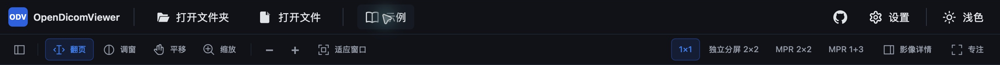

# 顶部对齐与桌面显示复查

日期：2026-11-02。实施方记录，独立评审待补；不是全部路线图交付或桌面发布验收。

## 交付范围

- `packages/app-web/src/index.css`：页头左右外边距从 32px 收到 12px，与工具栏共用 `--workspace-edge`；保留窄屏换行、工具栏滚动和主题单按钮切换。
- `docs/design/tokens.md`：同步外边距 token。
- `docs/ANNOTATION_PLAN.md`：细化已确认的标注/测量范围、删除与撤销、帧归属、物理标定和保存恢复验收。状态仍为待实现，不新增虚假工具入口。

顶部证据（打包客户端、教学数据；裁剪不包含患者信息）：

## 桌面显示：未解决

本机 macOS 15.1.1 的打包 Debug 应用上，MR 示例初次进入 MPR 可完整显示；反复 2×2 ↔ 1+3 并切换主题后，仍可出现文字和影像局部截断。用户此前已确认实际窗口同样存在故障，不能归为截图误差。

本轮对照过绘制隔离、将 MPR 覆盖层放入对应画布容器、整页合成层、2D 显示画布的 `willReadFrequently`、渲染完成后的读取同步，以及 Tiled 与默认 ContextPool 路径组合。部分候选首轮看似正常，第二轮或第五轮再次失败；全部撤回，未提交这些实验。保持 CS3D 4.22.13、默认渲染模式和现有影像通路。

失败复现证据临时保存在 `/tmp/odv-mpr-portal-failed.png`；构建日志为 `/tmp/odv-portal-build.log`、`/tmp/odv-rootlayer-build.log`、`/tmp/odv-canvas-build.log`、`/tmp/odv-flush-build.log`、`/tmp/odv-tiled-surface-build.log`。这些日志只能证明构建成功，不能证明修复成功。

下一项应为独立最小复现，区分 WebKit 合成与 CS3D 画布内容错误，避免继续叠加未经多轮回归的补丁。显示/坐标门槛未通过前，不宣称桌面测量或多视口导出可用。

## 真实 ZIP

用户授权的下载目录内三份 ZIP，经 `zipfile` 逐条读取 132 字节确认：分别为 25、2、2 个带 DICM 魔数的文件，各含一个目录项，没有额外普通文件。输入及截图均不提交仓库。

实际从访达将 25 帧 ZIP 拖入空欢迎页：显示 1 个序列、25 帧，无导入错误横幅；首帧与第 13 帧实际出图，层号可定位到 25/25。此为 Tauri 原生拖放链路验证，不能替代 Web 拖放，也不代表逐帧像素比对完成。

另一份 2 文件 ZIP 拖入后显示“定位像 / 二次采集（二维）”、2 帧、“无物理标尺”“层间距不适用”；不再错误地只保留一张或开放 MPR。实际翻到 2/2 后可见 SC 及其像素内原有的扫描规划线。第三份 ZIP 及取消/失败清单仍需覆盖。

## 验证边界

- `pnpm typecheck`、`pnpm lint`、`pnpm test`：通过；工作树 26 个测试文件、281 项。
- Tauri Debug `.app`：构建、启动成功；顶部对齐在实际原生窗口核对。当前构建日志 `/tmp/odv-header-build.log`。
- Web 构建：`pnpm --filter @opendicomviewer/app-web build` 通过；保留已有的大 chunk 提示，未改包体积门槛。
- Web 窄屏与拖放：浏览器自动审批拒绝访问 `http://127.0.0.1:5173/`，原因为已保存的权限设置阻止该地址；用户回复已允许后重新尝试，工具仍返回相同拒绝，未绕过访问限制。
- 原有 7 个未提交文件逐个 SHA256 比对 `/tmp/odv-desktop-protected.json`，全部未改动；`.trae/` 保留。上述工作树测试包含这些原有改动，不将它们混入本次提交。
