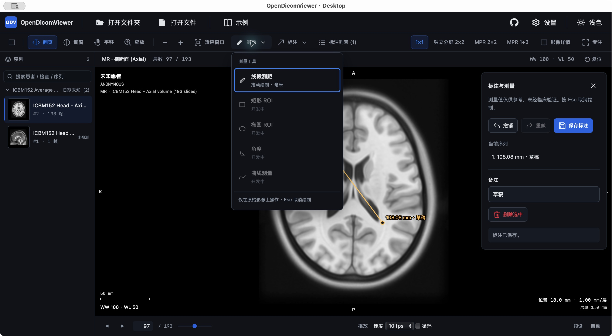
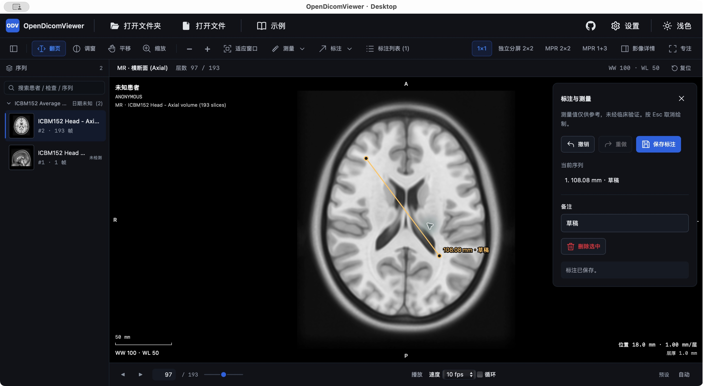
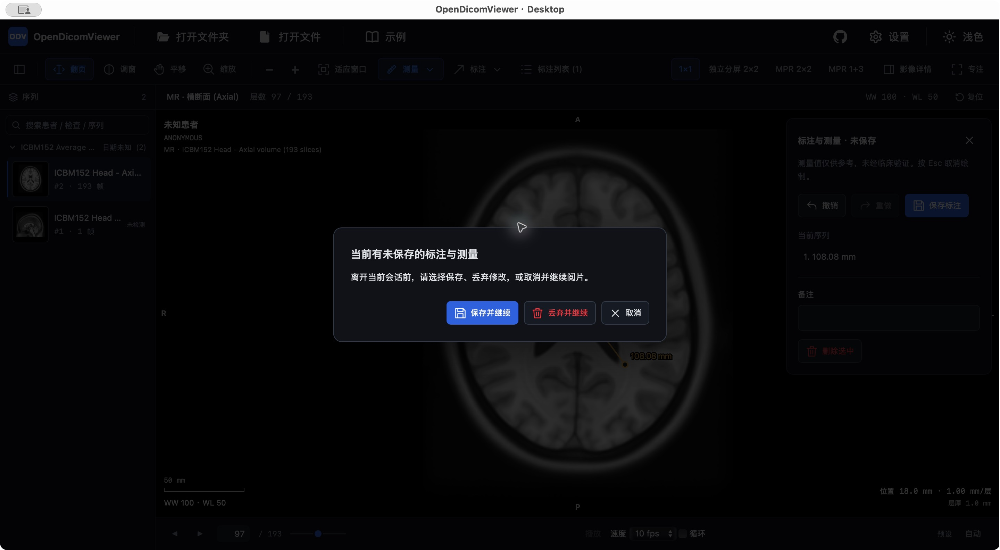

# 基础工具、二维播放与保存保护交付

日期：2026-11-04。本轮交付可见的工具增量，未宣称 Phase 1/2 整体完成。教学样本验证，不上传下载目录的真实患者文件。

## 实现范围

- 原始 1×1 Stack：线段测距、箭头、文字、图形选择/移动与控制点、备注、列表定位、删除、撤销/重做。源帧绑定 session/series/SOP/frame；以原始像素与可信间距计算，不在降采样 MPR 上测量。
- 顶部收为图标化「测量」「标注」菜单和列表入口；矩形、椭圆、角度、曲线、手绘显示开发中。菜单采用 Portal，支持键盘方向键、Esc 和外部关闭。
- 面板及离开确认有独立按钮边界、保存主按钮、删除危险色、内描边焦点与独立提示区；成功状态不再使用错误红色。未引入图标库、外部资源或新依赖。
- 版本化 JSON 显式保存。Tauri 原生选目标、小文本 IPC、临时文件完整写入后发布；取消/失败保留 dirty。Web 下载发起不等于写入成功，需要用户确认；尚无恢复入口。
- 离开/替换前提交备注草稿，保存同一快照；保存期间新修改不被误记为已保存。Logo 回首页保留工作区。浏览器 beforeunload、桌面关闭和 Cmd+Q 接入保护。
- macOS 默认 Quit 直接调用系统 terminate:，实测会绕过仅 RunEvent 的尝试；已将该菜单替换为普通 Cmd+Q 菜单事件，等待前端确认。保留其他默认菜单。
- Cine：单格与独立分屏活动格，播放/暂停、1–60 fps 选项、循环、末帧停止/重播；等待异步导航完成再排下一帧，切会话/布局/覆盖层暂停。这是二维帧浏览，不是4D。

主要文件：app-web/src/annotations、Viewport、WorkspaceToolbar、SplitWorkspace、CineControls/controller、App、host-save/close桥；core/domain/types与measurement/session；app-tauri入口、Rust保存/退出及能力配置。

## 实际验证

| 验证 | 结果与边界 |
| --- | --- |
| `pnpm typecheck` / `pnpm lint` | 通过 |
| `pnpm test` | 30 文件、324 项通过；预期 Worker 熔断测试会输出回退说明 |
| `cargo test --manifest-path packages/app-tauri/src-tauri/Cargo.toml` | 5 项通过，含完整替换与发布失败保留目标/清理临时文件 |
| `pnpm --filter @opendicomviewer/app-web build` | 通过；仍有既有大 chunk 提醒 |
| `pnpm --filter @opendicomviewer/app-tauri exec tauri build --debug --bundles app` | 通过，完整应用包已打开，非合成绘制排查壳 |
| 原生 GUI 工具 | MR 教学第97层拖动，显示108.08 mm；备注“验收备注”更新叠加与列表；删除后撤销恢复记录 |
| 原生保存取消/读回 | Cancel 后保留修改；原生实际文件读回1条length，image-pixel，frameIndex0，lengthMm=108.07736063708761。独立SOP的第97层仍是实例内frame0 |
| 未按回车的备注 | 已保存后输入“草稿”保持焦点直接Cmd+Q，弹出保护；取消后再保存，`/tmp/odv-tools-draft-20261104.json`读回text=草稿，长度和源帧引用保留 |
| Cmd+Q与视觉 | 新包Cmd+Q显示确认，Esc取消保留会话；菜单、面板与确认框实测无按钮/提示重叠，见截图 |
| Cine | 实际由97层自动推进至103层，后至193层停止；不代表所有速度/循环与独立分屏GUI已验收 |

独立审查见 CR-2026-11-04-tools-ui 及 r2–r6，历史发现报告保留。依次关闭模态快捷键穿透、复位重投影、基础热键未退出工具、跨帧Delete误删、备注草稿退出遗漏、旧快照保存提示、菜单上下文测试与短视窗负坐标。独立复审和原生 GUI 是不同证据层。

## 未覆盖与后续

Web 最新实际交互仍受此前本地访问审批限制，未绕过；Windows/Linux未实测。原生窗口×/菜单Quit、全部控制点编辑、跨帧Delete、所有Cine速度/循环与分屏播放仍需扩大GUI回归，不能由构建通过推定完成。

D1 macOS MPR 重绘问题保留已知风险，按用户指示不阻塞可靠的 Stack 工具推进。ROI/HU、角度/Cobb、曲线/手绘、分屏测量、JSON恢复、PNG/原始DICOM/SR/GSPS、3D/4D与完整Demo Gate仍未交付；队列见IMPLEMENTATION_PLAN。原图未写入备注，JSON不是标准DICOM结果对象。

远端以本次提交后的CI/Pages检查为准；本地结果不冒充已部署。
