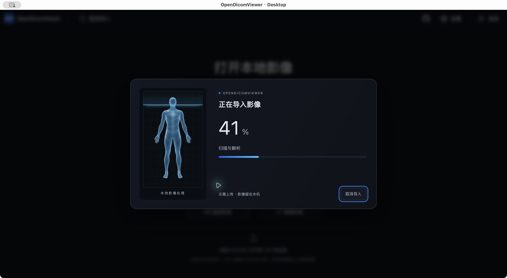

# 加载人像越框修复

2026-11-05。原图像铺在外容器，而扫描网格另有10px内缩，造成头顶可超过内框。

现在图片、网格、光带共用 import-scan-window；图片按比例 contain 并留12px内距，光带终点由相同高度变量计算且统一裁剪。默认274px、小屏222px，caption位于框外。

`pnpm typecheck`、`pnpm lint`、Web构建、完整Tauri Debug构建通过；纯布局修正未新增复述CSS的行为测试。独立复核见 CR-2026-11-05-import-frame.md。

主线重启新桌面包并载入教学样本，实际看到头顶、手脚完整留在网格内，纯百分比保留；截图如下。尚未实测所有窄屏及极低窗口。

